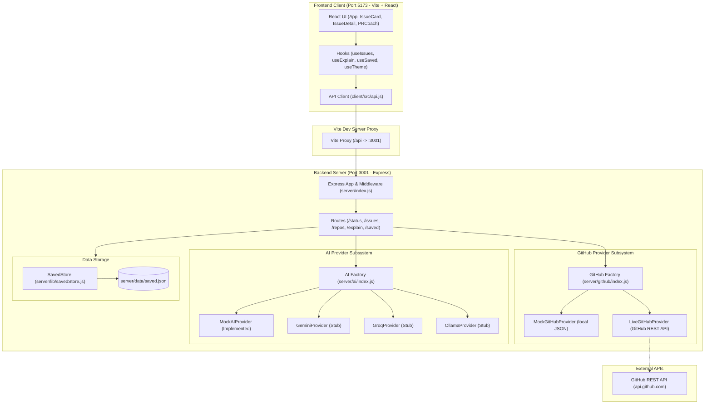
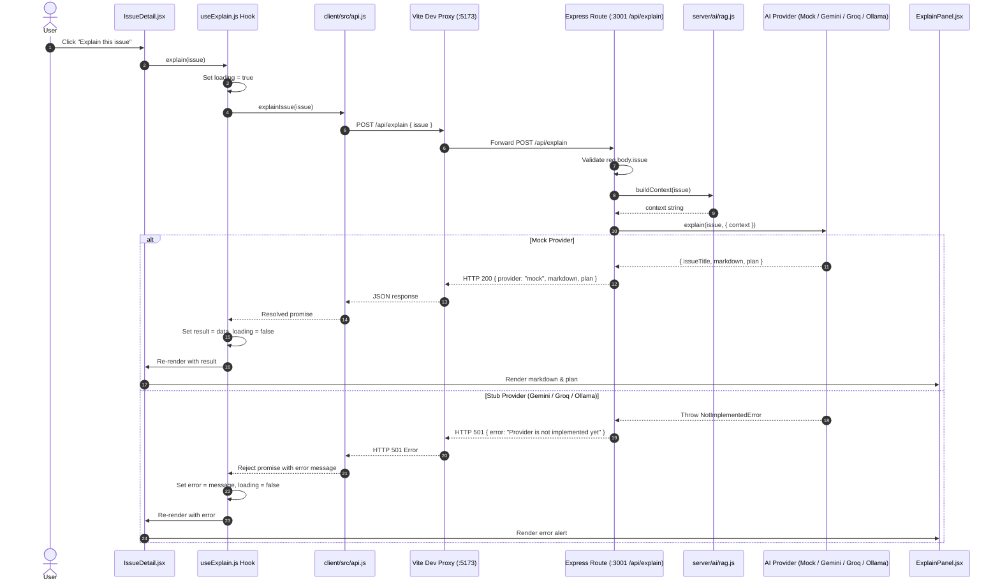

# Open Source Buddy — Architecture Guide

This document describes the high-level architecture, subsystem designs, and data flow of **Open Source Buddy**, an AI-assisted web application built to help developers discover, understand, and start contributing to beginner-friendly open-source issues.

---

## Table of Contents

1. [System Overview](#system-overview)
2. [Architecture Diagram](#architecture-diagram)
3. [Client / Server Split](#client--server-split)
4. [Frontend Architecture (React + Vite)](#frontend-architecture-react--vite)
5. [Backend Architecture (Express)](#backend-architecture-express)
6. [GitHub Provider Subsystem](#github-provider-subsystem)
   - [Provider Interface](#github-provider-interface)
   - [Mock Mode vs Live Mode](#mock-mode-vs-live-mode)
   - [Caching Layer](#caching-layer)
7. [AI Provider Subsystem](#ai-provider-subsystem)
   - [Provider Interface](#ai-provider-interface)
   - [Implementation Status (Mock vs Stubs)](#ai-provider-implementation-status)
   - [RAG Context Construction](#rag-context-construction)
8. [Request Lifecycle: "Explain this issue"](#request-lifecycle-explain-this-issue)
   - [Step-by-Step Flow](#step-by-step-flow)
   - [Sequence Diagram](#sequence-diagram)
9. [Issue Persistence (Saved Issues)](#issue-persistence-saved-issues)
10. [Configuration & Environment Variables](#configuration--environment-variables)

---

## 1. System Overview

Open Source Buddy is built as a lightweight, full-stack JavaScript application split into a **React single-page application (SPA)** on the frontend and an **Express REST API** on the backend.

Key design principles include:
- **Pluggable Providers**: Abstract interfaces decouple core business logic from external services (GitHub REST API and AI model providers).
- **Offline-First / Zero-Config Development**: By default, the application runs entirely offline using bundled mock data and a heuristic mock AI provider without requiring any API keys or internet connection.
- **Strict Secret Isolation**: All tokens and keys remain on the backend server and are never exposed to the client browser.

---

## 2. Architecture Diagram



---

## 3. Client / Server Split

The repository is organized as an npm workspace monorepo configured in the root `package.json`:

```json
{
  "workspaces": ["server", "client"]
}
```

Running `npm run dev` in the project root launches `concurrently`, running both workspaces in parallel:
- **Client**: Vite dev server running on `http://localhost:5173`.
- **Server**: Express HTTP server running on `http://localhost:3001`.

### Development Proxy
To avoid Cross-Origin Resource Sharing (CORS) hurdles during local development, Vite is configured in `client/vite.config.js` to proxy `/api` requests to port 3001:

```javascript
server: {
  port: 5173,
  proxy: {
    '/api': 'http://localhost:3001',
  },
}
```

This architecture means:
1. The frontend code issues standard relative fetch calls (e.g., `fetch('/api/issues')`).
2. In production, a reverse proxy (like Nginx) or static file hosting from Express can serve the built frontend assets directly.
3. Secrets, environment variables, rate limiting, and filesystem operations remain completely confined to the Node.js runtime.

---

## 4. Frontend Architecture (React + Vite)

The frontend is a React 18 single-page application bundled with Vite.

```
client/
├── index.html                  # HTML entry point
├── vite.config.js              # Vite server & proxy configuration
└── src/
    ├── main.jsx                # React root bootstrap
    ├── App.jsx                 # Central app layout and state management
    ├── api.js                  # Centralized fetch wrapper for backend endpoints
    ├── components/             # Reusable UI components
    │   ├── App.jsx
    │   ├── AuthButton.jsx      # Placeholder sign-in / user button
    │   ├── CopyPlanButton.jsx  # Clipboard copy utility for generated plans
    │   ├── ExplainPanel.jsx    # Explanation container (markdown + plan steps)
    │   ├── Filters.jsx         # Language and topic dropdown filters
    │   ├── HealthBadge.jsx     # Visual indicator of repo health score
    │   ├── IssueCard.jsx       # Feed item card with labels and repo info
    │   ├── IssueDetail.jsx     # Side panel drawer for selected issue & actions
    │   ├── Markdown.jsx        # Lightweight markdown renderer
    │   ├── Pagination.jsx      # Page navigation controls
    │   ├── PRCoach.jsx         # PR preparation and contribution tips tab
    │   ├── SampleBanner.jsx    # Yellow notification banner shown in mock mode
    │   ├── SavedSidebar.jsx    # Drawer list of bookmarked issues
    │   ├── SearchBar.jsx       # Text query search input
    │   ├── SortBar.jsx         # Issue sort criteria selector
    │   ├── Spinner.jsx         # Loading spinner
    │   ├── ThemeToggle.jsx     # Dark / light theme toggle button
    │   └── TrackButton.jsx     # Bookmark / save toggle button
    ├── hooks/                  # Custom React hooks
    │   ├── useExplain.js       # Manages explanation fetch lifecycle & state
    │   ├── useIssues.js        # Manages issue listing, queries, and pagination
    │   ├── useSaved.js         # Manages fetching, adding, and removing saved issues
    │   └── useTheme.js         # Manages light/dark theme persistence
    ├── styles/                 # Scoped stylesheet modules
    └── utils/
        └── formatAge.js        # Relative timestamp helper
```

### Key Frontend Data Flows
- **Global / Shared State (`App.jsx`)**: Tracks active view tabs (`issues` vs `coach`), current filter settings (`q`, `language`, `topic`, `sort`, `page`), selected issue drawer state, and backend status from `GET /api/status`.
- **API Encapsulation (`api.js`)**: All communication with the server passes through dedicated async functions (`getIssues`, `getHealth`, `explainIssue`, `getSaved`, `saveIssue`, `unsaveIssue`, `getStatus`).

---

## 5. Backend Architecture (Express)

The backend is a Node.js Express server (`server/index.js`) responsible for data aggregation, external API integration, AI generation, and local persistence.

```
server/
├── index.js                    # Express bootstrap and top-level error handling
├── config.js                   # Reads process.env and defaults
├── middleware/
│   └── rateLimit.js            # Request throttling middleware stub
├── routes/
│   ├── index.js                # Main router (/api) and status endpoint
│   ├── issues.js               # GET /api/issues (filtering & pagination)
│   ├── health.js               # GET /api/repos/:owner/:name/health
│   ├── explain.js              # POST /api/explain (AI issue explanation)
│   ├── explainStream.js        # POST /api/explain/stream (streaming stub)
│   └── saved.js                # GET/POST/DELETE /api/saved (persisted bookmarks)
├── github/                     # GitHub provider subsystem
├── ai/                         # AI provider subsystem
├── auth/
│   └── currentUser.js          # Resolves current user id ('anonymous')
└── lib/
    ├── filters.js              # In-memory query, language, and topic filters
    ├── sort.js                 # Issue sorting logic
    ├── paginate.js             # Slicing and page metadata calculation
    ├── healthScore.js          # 0-100 repository health score formula
    └── savedStore.js           # JSON file reading and writing
```

### Express Routes Summary

| Method | Route | Description |
|---|---|---|
| `GET` | `/api/status` | Exposes non-sensitive config: `{ githubMode, aiProvider }`. |
| `GET` | `/api/issues` | Lists issues with query params: `q`, `language`, `topic`, `sort`, `page`. |
| `GET` | `/api/repos/:owner/:name/health` | Computes health metrics and health score for a specific repo. |
| `POST` | `/api/explain` | Generates a plain-English explanation, likely files, and starting plan. |
| `POST` | `/api/explain/stream` | Streaming explanation stub (returns `501 Not Implemented`). |
| `GET` | `/api/saved` | Returns all saved issues for the current user. |
| `POST` | `/api/saved` | Adds an issue to the current user's saved list. |
| `DELETE` | `/api/saved/:id` | Removes an issue from the current user's saved list. |

---

## 6. GitHub Provider Subsystem

The GitHub data layer utilizes the **Provider Pattern** to decouple the rest of the application from GitHub API specifics.

### GitHub Provider Interface
Every provider extends `GitHubProvider` (`server/github/provider.js`):

```javascript
export class GitHubProvider {
  get name() { /* returns string: 'mock' | 'live' */ }
  async listIssues({ q, language, topic }) { /* returns Issue[] */ }
  async getRepoHealth(owner, name) { /* returns health metrics | null */ }
  async getRepoFile(owner, name, path) { /* returns file contents string | null */ }
}
```

Standardized `Issue` shape:
```javascript
{
  id: number | string,
  number: number,
  title: string,
  body: string,
  repo: "owner/name",
  url: string,
  labels: string[],
  language: string | null,
  topics: string[],
  comments: number,
  createdAt: string // ISO date string
}
```

### Mock Mode vs Live Mode

| Feature | Mock Mode (`GITHUB_MODE=mock`) | Live Mode (`GITHUB_MODE=live`) |
|---|---|---|
| **Data Source** | Local JSON files (`server/github/mockData/issues.json` and `repos.json`) | GitHub REST API (`https://api.github.com`) |
| **Internet Required** | No (works completely offline) | Yes |
| **Authentication** | None needed | Optional `GITHUB_TOKEN` |
| **Rate Limit** | Unlimited | 60 req/hour unauthenticated; 5,000 req/hour with token |
| **Timestamps** | Dynamically computed from `daysAgo` offsets so sample data never appears stale | Real timestamps from GitHub (`created_at`) |
| **UI Indication** | Yellow **Sample data** banner rendered in header | Banner hidden |

### Caching Layer
In `server/github/index.js`, the active provider is wrapped with `withCache(provider)` (`server/github/cache.js`). Currently, this is a passthrough function serving as an extension point for short-term in-memory caching to safeguard GitHub rate limits.

---

## 7. AI Provider Subsystem

Similar to the GitHub layer, the AI subsystem employs the Provider Pattern.

### AI Provider Interface
All providers extend `AIProvider` (`server/ai/provider.js`):

```javascript
export class AIProvider {
  get name() { /* returns string */ }
  async explain(issue, { context }) { /* returns { markdown, plan } */ }
  async *explainStream(issue, opts) { /* async generator yielding text chunks */ }
}
```

If a provider or method has not been implemented, it throws `NotImplementedError` with code `'NOT_IMPLEMENTED'`, which Express catches and converts into an HTTP `501 Not Implemented` response.

### AI Provider Implementation Status

| Provider | Config Identifier | Key / URL Variable | Status | Implementation Details |
|---|---|---|---|---|
| **Mock** | `mock` | None | **IMPLEMENTED** | Uses rule-based regex extraction and heuristic templates. Requires no external service or API key. |
| **Gemini** | `gemini` | `GEMINI_API_KEY` | **STUB** | Defined in `server/ai/gemini.js`; throws `NotImplementedError`. |
| **Groq** | `groq` | `GROQ_API_KEY` | **STUB** | Defined in `server/ai/groq.js`; throws `NotImplementedError`. |
| **Ollama** | `ollama` | `OLLAMA_URL` | **STUB** | Defined in `server/ai/ollama.js`; throws `NotImplementedError`. |

> [!IMPORTANT]
> At the time of writing, **only the Mock provider (`MockAIProvider`) is implemented**. The Gemini, Groq, and Ollama providers exist as structural stubs with defined configuration bindings and interfaces ready for future implementation.

#### How `MockAIProvider` Works
`MockAIProvider` (`server/ai/mock.js`) generates high-quality beginner summaries deterministically:
1. **Plain English Summary**: Extracts the opening sentences of the issue description using sentence boundary regex.
2. **Likely Files**: Uses a file pattern regex (`/[\w./-]+\.(?:jsx?|tsx?|py|rs|go|java|css|html|md|json)\b/g`) to identify file paths mentioned in the issue title or body. If none are found, it falls back to inspecting labels (e.g., suggesting `README.md` and `docs/` for documentation issues, or `src/` for code issues).
3. **Starting Plan**: Constructs a step-by-step checklist tailored to open source newcomers (forking, cloning, locating the identified files, reproducing the issue, and opening a PR referencing the issue number).

### RAG Context Construction
`server/ai/rag.js` exports `buildContext(issue)`. This module is designed for Retrieval-Augmented Generation (RAG) by fetching repository documentation (e.g., `README.md` and `CONTRIBUTING.md`) through `github.getRepoFile()`. Currently, it returns an empty string (`''`) as a placeholder.

---

## 8. Request Lifecycle: "Explain this issue"

### Step-by-Step Flow

1. **User Action**: The user browses the issue feed and clicks on an issue card. This mounts `IssueDetail.jsx` with the selected issue.
2. **Button Click**: The user clicks the **Explain this issue** button in `IssueDetail.jsx`.
3. **Hook State Transition**: The `useExplain` hook (`client/src/hooks/useExplain.js`) triggers `explain(issue)`.
   - `loading` is set to `true`.
   - The button text changes to `"Thinking…"`.
   - Previous errors or results are reset.
4. **Client Network Request**: `explainIssue(issue)` in `client/src/api.js` executes:
   ```javascript
   fetch('/api/explain', {
     method: 'POST',
     headers: { 'Content-Type': 'application/json' },
     body: JSON.stringify({ issue })
   })
   ```
5. **Proxy Forwarding**: Vite's development proxy receives the `/api/explain` request on port 5173 and forwards it to `http://localhost:3001/api/explain`.
6. **Express Route Handling**:
   - `server/index.js` parses the JSON body (`express.json({ limit: '200kb' })`).
   - The request hits the router in `server/routes/explain.js`.
   - Validation ensures `issue` and `issue.title` exist; otherwise, it responds with HTTP `400 Bad Request`.
7. **Context & AI Execution**:
   - `buildContext(issue)` in `server/ai/rag.js` is invoked to gather repository context.
   - `ai.explain(issue, { context })` is executed on the active provider singleton (`server/ai/index.js`).
   - If using `MockAIProvider`, heuristics parse the issue text and generate `{ issueTitle, markdown, plan }`.
   - If an unimplemented provider (Gemini, Groq, or Ollama) is configured, a `NotImplementedError` is thrown, caught, and returned as HTTP `501 Not Implemented`.
8. **Server Response**: The server sends a JSON response:
   ```json
   {
     "provider": "mock",
     "issueTitle": "Issue title here",
     "markdown": "# Explaining: ...",
     "plan": ["Fork repository...", "Clone fork...", "..."]
   }
   ```
9. **UI Update**:
   - `useExplain` updates its state (`loading: false`, `result: responseData`).
   - `ExplainPanel.jsx` receives `result` and renders:
     - The AI provider name tag (`AI provider: mock`).
     - The `CopyPlanButton` component for copying the plan to clipboard.
     - The markdown summary via `Markdown.jsx`.

### Sequence Diagram



---

## 9. Issue Persistence (Saved Issues)

Users can bookmark issues to revisit them later using the bookmark button (`TrackButton.jsx`) or the card save button.

### Storage Architecture
- **Location**: Bookmarks are saved in `server/data/saved.json`.
- **Data Format**: A JSON object mapping user identifiers to arrays of saved issue objects:
  ```json
  {
    "anonymous": [
      {
        "id": 101,
        "number": 42,
        "title": "Fix broken navigation link",
        "repo": "owner/repo",
        "url": "https://github.com/owner/repo/issues/42"
      }
    ]
  }
  ```
- **User Scoping & Authentication**:
  - `server/auth/currentUser.js` defines `getCurrentUserId(req)`.
  - Currently, it returns `'anonymous'` for all requests. When GitHub OAuth is integrated in the future, this function will extract the authenticated user identity (e.g., from a session cookie or JWT).
- **Operations (`server/lib/savedStore.js`)**:
  - `readAll()`: Reads and parses `server/data/saved.json`. If the file does not exist (`ENOENT`), it gracefully returns `{}`.
  - `writeAll(data)`: Automatically ensures the `server/data/` directory exists using `fs.mkdir(config.dataDir, { recursive: true })` and writes the JSON with 2-space indentation.
  - `listSaved(userId)`: Returns the array of issues for `userId` (or `[]`).
  - `addSaved(userId, issue)`: Appends an issue to the user's bucket and writes to disk.
  - `removeSaved(userId, id)`: Filters out the specified issue by `id` and writes to disk.
- **Git Ignore**: `server/data/saved.json` is created automatically at runtime and is excluded from source control in `.gitignore`.

---

## 10. Configuration & Environment Variables

Server configuration is centralized in `server/config.js` and loaded via `dotenv` from a root `.env` file (`.env.example` serves as the template):

| Variable | Default Value | Purpose |
|---|---|---|
| `PORT` | `3001` | Port on which the Express API server listens. |
| `GITHUB_MODE` | `mock` | GitHub provider to load: `mock` (offline JSON) or `live` (GitHub REST API). |
| `GITHUB_TOKEN` | `""` | Optional GitHub Personal Access Token to raise REST API rate limits from 60 to 5,000 req/hr. |
| `AI_PROVIDER` | `mock` | AI provider to initialize: `mock`, `gemini`, `groq`, or `ollama`. |
| `GEMINI_API_KEY` | `""` | API key for Google Gemini (used when `AI_PROVIDER=gemini`). |
| `GROQ_API_KEY` | `""` | API key for Groq Cloud (used when `AI_PROVIDER=groq`). |
| `OLLAMA_URL` | `http://localhost:11434` | Endpoint for local or networked Ollama instance (used when `AI_PROVIDER=ollama`). |

### Security & Secret Isolation
1. **Never sent to the browser**: The frontend build (Vite) does not bundle or expose these environment variables.
2. **Safe status exposure**: The `GET /api/status` endpoint exposes only non-sensitive operational mode strings:
   ```json
   {
     "githubMode": "mock",
     "aiProvider": "mock"
   }
   ```
3. **Git safety**: `.env` is listed in `.gitignore` to prevent credentials from ever being committed to source control.
