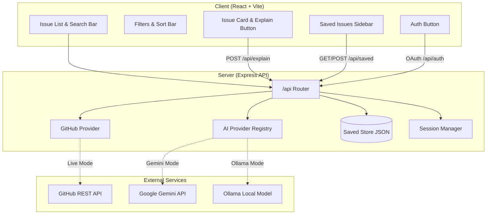

# Open Source Buddy Architecture

This document describes the design, directory organization, and data flow of Open Source Buddy.

---

## 1. Client/Server Split

Open Source Buddy is split into two cleanly separated packages:
- **Client (`client/`)**: A single-page application built with **React 18**, **Vite**, and **Tailwind CSS**. Served on `http://localhost:5173`.
- **Server (`server/`)**: An **Express** REST API running on `http://localhost:3001` that proxies GitHub queries, interfaces with AI explanation engines, and manages persisted bookmarks.

The Vite dev server proxies API calls matching `/api` directly to `http://localhost:3001`.

---

## 2. GitHub Provider Pattern

All GitHub operations are encapsulated behind the `GitHubProvider` abstraction (`server/github/`):
- **Mock Provider (`mock.js`)**: Returns static seed data from `server/data/seed/`. Requires zero API tokens and zero network connectivity. Perfect for local offline development.
- **Live Provider (`live.js`)**: Connects to the GitHub REST API using `GITHUB_TOKEN`, querying public issues, fetching `README.md` and `CONTRIBUTING.md`, and calculating maintainer responsiveness.
- **Cache Layer (`cache.js`)**: In-memory TTL cache preventing unnecessary repeated queries and avoiding rate limits.

---

## 3. AI Provider Pattern

AI issue explanations are decoupled from any specific model provider via the `AIProvider` interface (`server/ai/provider.js`):
- **Mock Provider (`mock.js`)**: Generates instant structured explanations and action plans locally.
- **Gemini Provider (`gemini.js`)**: Calls Google's Gemini API via REST with structured output instructions.
- **Ollama Provider (`ollama.js`)**: Interfaces with locally running LLMs (e.g. `llama3`, `mistral`) via Ollama's HTTP API at `http://localhost:11434`.
- **Groq Provider (`groq.js`)**: Provider stub for Groq Llama-3 acceleration.

---

## 4. "Explain this issue" Execution Flow

When a user clicks **Explain this issue**:
1. **Client Event**: `ExplainPanel` invokes the `useExplain` hook.
2. **API Request**: `POST /api/explain` is dispatched with issue metadata (`title`, `body`, `url`, `repository`).
3. **RAG Context**: `server/ai/rag.js` fetches `README.md` and `CONTRIBUTING.md` from the issue repository to inject project guidelines.
4. **AI Generation**: The active AI provider produces structured Markdown summary and numbered plan steps.
5. **Streaming / Response**: Data streams back via SSE or returns as JSON `{ markdown, plan }`.
6. **Safe Rendering**: `Markdown.jsx` sanitizes and renders structured headings, lists, and code blocks.

---

## 5. Storage & Persistence

Bookmarks are persisted using `server/lib/savedStore.js`:
- Saved issues are stored on disk in `server/data/saved.json`.
- Each user maintains an isolated bucket: `{ "<userId>": [issue, ...] }`.
- Anonymous users use the `anonymous` bucket; authenticated users use their GitHub username or ID.

---

## 6. Environment Variables

| Variable | Description | Default |
|---|---|---|
| `PORT` | Backend HTTP port | `3001` |
| `GITHUB_MODE` | `mock` or `live` | `mock` |
| `GITHUB_TOKEN` | Personal Access Token for live GitHub queries | (empty) |
| `AI_PROVIDER` | `mock`, `gemini`, `ollama`, or `groq` | `mock` |
| `GEMINI_API_KEY` | Google Gemini API key | (empty) |
| `OLLAMA_URL` | Ollama server URL | `http://localhost:11434` |
| `GITHUB_CLIENT_ID` | GitHub OAuth app client ID | (empty) |
| `GITHUB_CLIENT_SECRET`| GitHub OAuth app client secret | (empty) |
